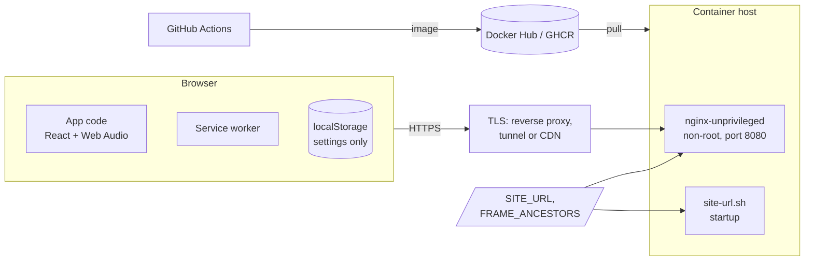

# Security

Whitenoise is a static site: no backend, no accounts, no forms, no cookies and no third-party requests. Its attack surface is the files it serves, the HTTP headers around them, the container that serves them and the pipeline that builds it.

## Reporting a vulnerability

Please report security issues privately through GitHub's **Report a vulnerability** button on the repository's Security tab, rather than in a public issue.

## Data and privacy

| Data | Where it lives | Leaves the device? |
| --- | --- | --- |
| Volume and settings (child-safe, calm visuals, chime) | `localStorage` key `whitenoise` | No |
| Chosen sound | Memory only | No |
| Lock-screen title and artwork | Sent to the OS Media Session | Stays on the device |

There is no analytics, tracking, advertising or external font/CDN request. Fonts are self-hosted; every request goes to the site's own origin.

## Threat model

| Risk | Mitigation |
| --- | --- |
| Script injection (XSS) | No HTML is built from user input; no `dangerouslySetInnerHTML`. CSP allows scripts only from the site itself (`script-src 'self'`, no inline scripts). |
| Clickjacking | `frame-ancestors` in the CSP, set by `FRAME_ANCESTORS` (default `'self'`). |
| Malicious embedding / opener tricks | `Cross-Origin-Opener-Policy: same-origin`; external links use `rel="noopener"`. |
| MIME confusion | `X-Content-Type-Options: nosniff`; explicit audio MIME types. |
| Unneeded browser features | `Permissions-Policy` disables camera, microphone, geolocation, payment and USB. |
| Bad `SITE_URL` value | `site-url.sh` accepts only `http(s)://host[:port][/path]` of safe characters; anything else is ignored with a warning, so it can't break the HTML, sitemap or `sed`. |
| Container compromise | Runs as uid 101 (non-root), `no-new-privileges` in Compose, minimal Alpine image. |
| Stale dependencies | Dependabot opens weekly PRs for npm, Docker base images and GitHub Actions. |
| Pipeline secrets | Docker Hub token used only by the login step; pull requests build without pushing or reading secrets. |

## HTTP headers

Set in `deploy/nginx.conf.template` on every response:

| Header | Value |
| --- | --- |
| `Content-Security-Policy` | `default-src 'self'; script-src 'self'; style-src 'self' 'unsafe-inline'; img-src 'self' data:; media-src 'self'; connect-src 'self'; worker-src 'self'; manifest-src 'self'; object-src 'none'; base-uri 'self'; form-action 'none'; frame-ancestors ${FRAME_ANCESTORS}` |
| `Cross-Origin-Opener-Policy` | `same-origin` |
| `X-Content-Type-Options` | `nosniff` |
| `Referrer-Policy` | `strict-origin-when-cross-origin` |
| `Permissions-Policy` | `camera=(), microphone=(), geolocation=(), payment=(), usb=()` |

Notes:

- `style-src 'unsafe-inline'` is needed for React's `style` attributes (CSS custom properties such as tile colors). It does not allow inline scripts.
- `img-src data:` is for the SVG noise textures generated in CSS.
- **HSTS** (`Strict-Transport-Security`) should be set where TLS ends: the reverse proxy, tunnel or CDN in front of the container. Setting it in the container would have no effect over plain HTTP between the proxy and the container.

## Container

- `nginxinc/nginx-unprivileged` runs nginx as uid 101 on port 8080.
- The site files are owned by uid 101 so `site-url.sh` can fill in `SITE_URL` at startup. The trade-off is that the root filesystem can't be mounted read-only; everything else is unchanged from the base image.
- `/healthz` backs the Docker health check.

## Known issues

- `npm audit` reports 2 low and 4 moderate issues in **build-time** packages pulled in by `vite-plugin-pwa` (`workbox-build`, `glob`, `minimatch`, `deepmerge`). None of them ship to the browser (`npm audit --omit=dev` reports 0), and the only fix today is a breaking downgrade, so they are accepted until Dependabot proposes a compatible update.
- GitHub Actions are pinned to major versions (`@v4`), not commit SHAs. Dependabot keeps them current; pinning to SHAs would be stricter.
