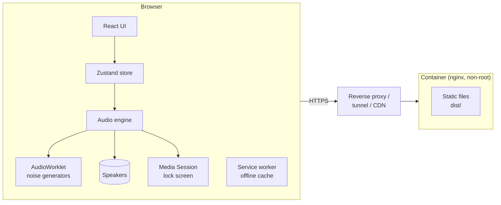
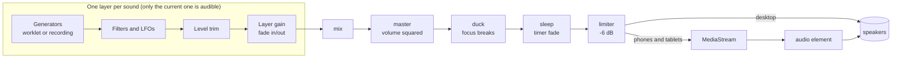
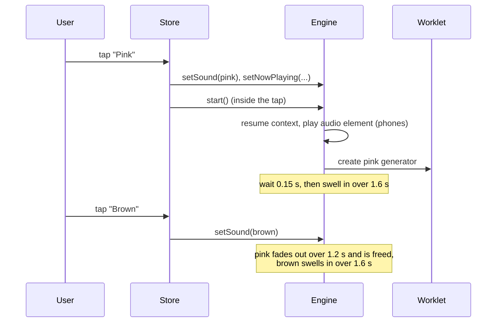
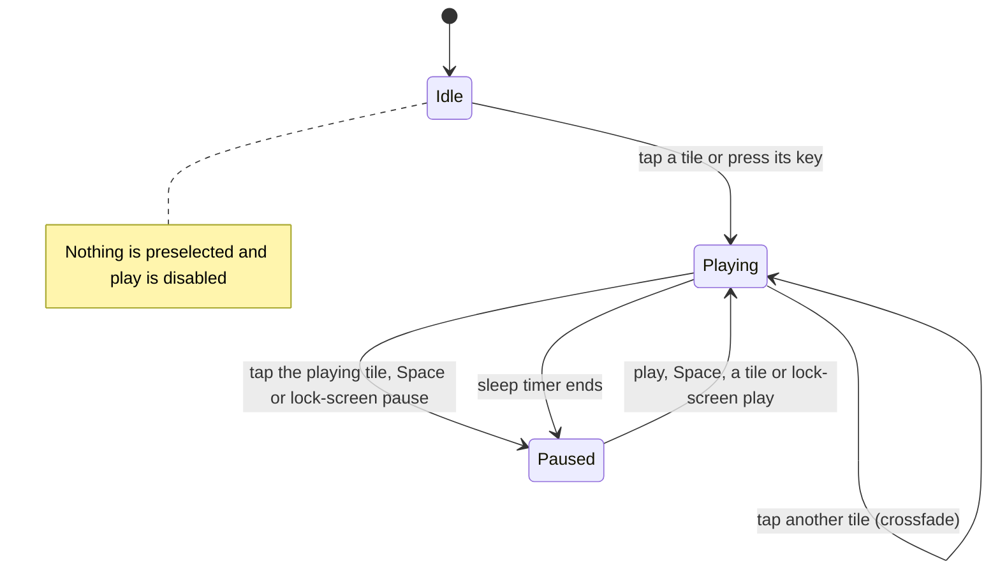
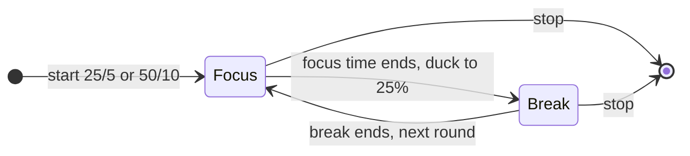
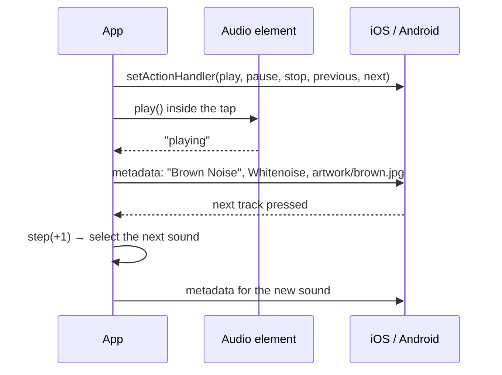
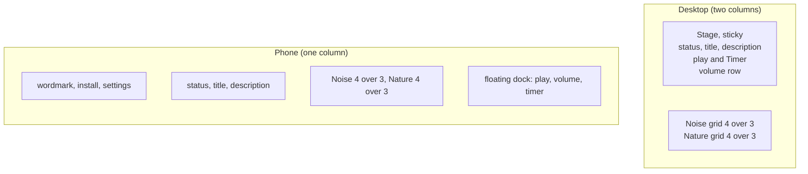
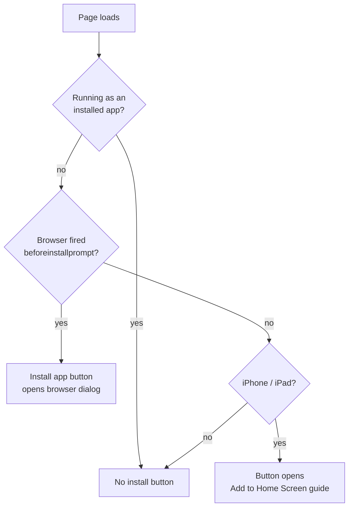
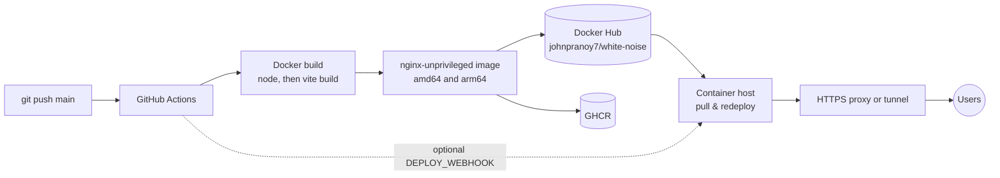
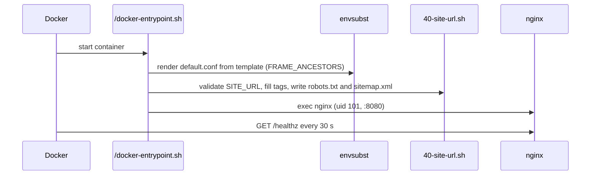

# Whitenoise: design

A browser app that plays one calming sound at a time, for focus or for sleep. Every sound is generated live in the browser; there is no backend. It ships as a small nginx container.

Related documents: [HEALTH.md](HEALTH.md) (health and safety), [../SECURITY.md](../SECURITY.md) (security and privacy), [LICENSING.md](LICENSING.md) (licenses).

## Contents

1. [Goals](#goals)
2. [System overview](#system-overview)
3. [Code map](#code-map)
4. [Audio engine](#audio-engine)
5. [Sound design](#sound-design)
6. [Playback and timers](#playback-and-timers)
7. [Lock screen and media keys](#lock-screen-and-media-keys)
8. [Interface](#interface)
9. [Settings](#settings)
10. [Installable app and offline](#installable-app-and-offline)
11. [Search engines and sharing](#search-engines-and-sharing)
12. [Build and deployment](#build-and-deployment)
13. [Decisions log](#decisions-log)
14. [Known limits](#known-limits)

## Goals

- **Calm, not busy.** One sound at a time; nothing starts on its own; every change in level is gradual.
- **Works for sleep on a phone.** Keeps playing with the screen locked, shows on the lock screen, and fades out on a timer.
- **Safe by default.** Quiet first volume, a child-safe mode, no sudden sounds, no medical claims (see [HEALTH.md](HEALTH.md)).
- **Tiny and easy to host.** No audio files are needed; the site is a few hundred kilobytes and runs in one container.

## System overview

There is no server-side logic: nginx serves the built files, and everything else happens in the browser.

## Code map

| Area | File | Role |
| --- | --- | --- |
| Generators | `src/audio/noise-processor.js` | AudioWorklet: stereo white/pink/brown/blue noise, rain drops, campfire crackle, underwater bubbles, crickets. Allocation-free on the audio thread. |
| Sound recipes | `src/audio/layers.ts` | Builds each sound from generators, filters and slow LFOs; per-sound level trims; loads optional recordings |
| Engine | `src/audio/engine.ts` | Web Audio graph, fades, ducking, sleep fade, output routing, Media Session |
| Catalogue | `src/audio/sounds.ts` | Names, keys, colors, descriptions, lock-screen titles and artwork |
| State | `src/state/store.ts` | Current sound, playback, volume, settings, timers (persisted: volume + settings) |
| UI | `src/App.tsx`, `src/components/*` | Stage, sound grid, player, timers, settings, install button, about, footer |
| Styles | `src/styles.css` | Design tokens, layout, tiles, motion |
| Page shell | `index.html` | SEO tags, structured data, crawler summary |
| Container | `Dockerfile`, `deploy/*` | nginx config template and startup script |
| CI | `.github/workflows/docker.yml` | Multi-arch image build and push |

## Audio engine

### Graph

- **Output routing.** Phones and tablets route through a MediaStream into an `<audio>` element: that is what keeps iOS playing with the screen locked and what gives the lock screen its controls. Desktops connect straight to the speakers, because the stream route can stutter while its buffer settles. If the element can't play, the engine falls back to the direct route.
- **One layer at a time.** Choosing a sound creates its layer; the previous one fades out and is disconnected so it stops using CPU.
- **Limiter.** A fast compressor at −6 dB catches peaks when the volume is high.

### Fades

All level changes use a raised-cosine S-curve that starts from the parameter's *current* value, so overlapping changes never jump.

| Change | Duration |
| --- | --- |
| New sound swells in | 0.15 s pause, then 1.6 s |
| Previous sound fades out | 1.2 s |
| Pause | 0.4 s |
| Resume | 1.6 s |
| Sleep timer | holds, then fades over the last half (max 20 min) |
| Focus break duck | to 25% over ~3 s |
| Volume slider | ~80 ms smoothing |

### Start-up and performance

- **Warm-up.** The worklet file is prefetched when the page is idle; the audio context is created on the first `pointerdown`/`keydown` (a user gesture, so no autoplay warning), a moment before the click that plays.
- **No garbage on the audio thread.** Drops, bubbles and crickets live in preallocated typed arrays, so the worklet never allocates or pauses for garbage collection.
- **Sleep fade on the audio clock.** The fade is scheduled in Web Audio, so it completes even when the browser throttles the page's timers in the background.

## Sound design

### Noise (keys 1–7, brightest to darkest)

| Sound | Recipe |
| --- | --- |
| Blue | First difference of pink noise (+3 dB/octave) |
| White | Uniform random samples |
| Grey | White noise through an inverted equal-loudness curve |
| Pink | Paul Kellet's filter on white noise (−3 dB/octave) |
| Green | Pink noise band-limited to ~120 Hz–1.8 kHz with a lift near 500 Hz |
| Brown | Leaky integration of white noise (−6 dB/octave) |
| Deep brown | Brown noise low-passed at 160 Hz |

Each stereo channel has its own generator, so the sound is wide rather than centred. Left out: **violet** (harsh, mainly for tinnitus masking), **black** (usually means silence), **orange** (no agreed definition).

### Nature (keys Q–U)

Tuned for relaxation: most energy below ~2.5 kHz, slow movement (LFOs of 0.03–0.4 Hz), no sharp transients, no whistling resonances.

| Sound | Recipe |
| --- | --- |
| Rain | Soft pink bed plus ~160 quiet drops/s, low-passed at 2.6 kHz, with a low body and slowly drifting intensity |
| Stream | Two broad, slowly drifting bands over a low bed |
| Ocean | A slow LFO opens the filter and raises the level together (a wave every ~12 s); a slower one varies wave size |
| Breeze | A wide, low band drifting very slowly, over a soft bed |
| Underwater | Deep muffled rush that swells slowly, plus occasional bubbles (sines that rise in pitch as they fade) |
| Campfire | Flickering airy roar, faint hiss, ~9 soft crackles/s kept near the centre and low-passed |
| Crickets | Five crickets at different distances chirping smooth 4–5 kHz pulses, ~5 dB under the rest |

Tried and dropped: **lake shore** (Crickets preferred), **cat purr** (sounded like helicopter blades). Never added: **thunder** and **cave drips** (startling), **waterfall** and **heavy rain** (too close to existing sounds), **birdsong/forest** (only convincing as recordings).

A recording listed in `public/sounds/manifest.json` replaces the synthesised version; it gets a 2 s equal-power crossfade baked into the loop point and is loudness-normalised.

### Levels

Every sound is trimmed to about −16 dB RMS at full volume, measured by rendering it offline. Exceptions, by ear: deep brown ~2 dB hotter (low sounds feel quieter), blue ~1.5 dB and crickets ~5 dB quieter (energy where the ear is most sensitive). Intermittent sounds (ocean, campfire) are matched on their loud moments. The slider value is squared before it reaches the gain.

## Playback and timers

- **Sleep timer** (15/30/60/90 min): holds full volume, then fades to silence over its last half (max 20 minutes), then pauses. Pausing cancels it.
- **Focus timer** (25 + 5 or 50 + 10 min): repeats until stopped; breaks lower the sound to 25%.
- **Child-safe mode** starts a 30-minute sleep timer whenever a sound plays.

## Lock screen and media keys

- Titles are title case ("Deep Brown Noise"); the artist is "Whitenoise"; the album is "Noise" or "Nature".
- Artwork: one 512×512 JPEG per sound in `public/artwork/` (30–50 KB each), matching its tile.
- Previous/next step through all 14 sounds and wrap around.
- Metadata is re-sent when playback actually starts, because iOS ignores details set before audio is playing.
- **Safari Private Browsing** shows the controls but hides the title and artwork; see [Known limits](#known-limits).

## Interface

- **Type:** Instrument Serif (display, wordmark 38/32 px, title up to ~108 px) and Geist (UI). Self-hosted.
- **Color:** warm near-black or paper off-white; the page takes a faint tint of the selected sound through a registered `@property`.
- **Tiles:** noise tiles are swatches in each noise's color with fine vertical lines (SVG turbulence, high horizontal frequency) and light grain; nature tiles are gradients with a line icon. Color and textures sit in an inner `.tile-fill` clipped with `clip-path: inset(0 round r)`, which keeps corners rounded on mobile browsers that otherwise stop clipping animated layers.
- **Grid:** four tiles over three, sized from the grid width with container query units so both rows are the same height.
- **Volume:** its own full-width row on desktop; a 32 px hit area; the track thickens 6→10 px on hover/drag; a percentage readout appears while adjusting.
- **Keyboard:** Space plays/pauses; 1–7 noise; Q–U nature.
- **Motion:** slow; disabled by Calm visuals and by the reduce-motion preference.

## Settings

Stored with the volume in `localStorage` (`whitenoise`, schema version 3; older versions migrate).

| Setting | Default | Effect |
| --- | --- | --- |
| Child-safe mode | Off | Caps played volume at 40% (the slider spans 0–40%); starts a 30-minute sleep timer on every play |
| Calm visuals | Off | Stops all animations |
| Timer chime | Off | Bell at focus/break changes; follows the volume |

## Installable app and offline

- The web app manifest, icons (192, 512, maskable, Apple touch) and a Workbox service worker make it installable. The service worker precaches the app shell, fonts and scripts; recordings are cached the first time they play.
- After a deploy, a returning visitor gets the update on their next load (the new service worker activates in the background).

## Search engines and sharing

- Title, description, canonical link, Open Graph/Twitter card (1200×630 image), and `WebApplication` structured data with author and license.
- A plain-HTML summary inside `#root` for crawlers that don't run JavaScript; React replaces it on load. The "About the sounds" section gives search engines real text.
- **`SITE_URL`** is filled in at container start by `deploy/site-url.sh`, which also writes `robots.txt` and `sitemap.xml`. Without it, tags that need an absolute URL are removed.

## Build and deployment

| Path | Cache | Why |
| --- | --- | --- |
| `/assets/*` | 1 year | Hashed filenames |
| `/sounds/*` | 30 days | Optional recordings |
| `/artwork/*` | 7 days | Lock-screen artwork; names aren't hashed |
| `/sounds/manifest.json` | no-cache | New recordings appear immediately |
| `/robots.txt`, `/sitemap.xml` | 1 day | Generated at startup |
| everything else | no-cache | App shell and service worker update on deploy |

Tags pushed on every `main` build: `latest`, `sha-<commit>` (for rollbacks) and `main`. Configuration (`FRAME_ANCESTORS`, `SITE_URL`) is described in the README.

## Decisions log

| Decision | Why |
| --- | --- |
| Generate sounds instead of shipping recordings | No licensing risk, never loops, tiny download |
| One sound at a time, no mixes | Noise and nature sounds don't blend well; one choice is calmer |
| Nothing plays until chosen | No surprises; required by browsers anyway |
| Desktop direct output, stream only on handhelds | Stream route stuttered at start on desktop; needed on phones for lock-screen playback |
| Default volume 40% | Quiet first impression; users raise it if needed |
| Chime off by default and volume-following | Sudden fixed-level sounds are hard for sound-sensitive users |
| Docker Hub as the primary registry | The deployment host pulls from Docker Hub |
| Fonts self-hosted | No third-party requests (privacy, CSP) |

## Known limits

- **Safari Private Browsing hides lock-screen details.** iOS shows the controls but leaves the title and artwork blank in private tabs. Normal Safari tabs and other browsers show everything. Confirmed with a four-way test of playback methods; only Private Browsing made the difference.
- **The lock-screen card stays after pausing.** iOS keeps it so playback can resume; it clears when the tab or app is closed. Releasing it automatically after a pause was considered and declined.
- **The browser can't measure real loudness**, so safety relies on defaults and guidance (see [HEALTH.md](HEALTH.md)).
- **Nature sounds are synthesised stand-ins**; CC0 recordings can replace them without code changes (see [LICENSING.md](LICENSING.md)).
