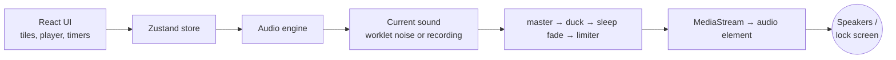

# Whitenoise: design

A browser app that plays one calming sound at a time, for focus or for sleep. It is a static site with no backend, served from a small nginx container on a home server behind a Cloudflare Tunnel.

## Goals

- **Calm, not busy.** One sound at a time, nothing starts on its own, and every change in volume is gradual.
- **Works for sleep on a phone.** Keeps playing with the screen locked and fades out on a timer instead of cutting off.
- **Tiny and self-hosted.** No audio files are needed, so the whole app is a few hundred kilobytes and runs in one container.

## Architecture



| Part | File | Role |
| --- | --- | --- |
| Noise generator | `src/audio/noise-processor.js` | AudioWorklet producing stereo white, pink and brown noise and the rain texture |
| Sound builders | `src/audio/layers.ts` | Shapes each sound from noise with filters and slow LFOs, or loads a recording |
| Engine | `src/audio/engine.ts` | Owns the Web Audio graph, fades, timers and the Media Session |
| Store | `src/state/store.ts` | App state: current sound, playing, volume, timers |
| UI | `src/App.tsx`, `src/components/` | Stage, sound grid and player |

### Audio graph

```
current sound ─▶ master (volume) ─▶ duck (focus breaks) ─▶ sleep (fade/timer) ─▶ limiter ─▶ MediaStream ─▶ <audio>
```

- **One layer at a time.** Selecting a sound creates its layer; the previous one fades out and is disconnected so it stops using CPU.
- **Fades** use a raised-cosine S-curve that starts from the parameter's current value, so a sound swells in (about 1.6 s), the old one fades out (1.2 s), and quick switches never jump.
- **Duck** lowers everything to 25% during focus-timer breaks.
- **Sleep** holds full volume, then ramps to silence over the last half of the timer (up to 20 minutes). The ramp is scheduled on the audio clock, so it still finishes when the browser throttles the page's timers.
- **Limiter** (a fast compressor at −6 dB) catches peaks.
- **Output through an `<audio>` element.** iOS pauses plain Web Audio when the screen locks; routing the mix through a MediaStream into a media element keeps it playing and gives lock-screen controls. If the element can't play, the engine falls back to connecting straight to the speakers.

## Sound design

### Noise (generated)

| Sound | How it's made |
| --- | --- |
| White | Uniform random samples |
| Pink | White noise through Paul Kellet's filter (−3 dB/octave) |
| Brown | Leaky integration of white noise (−6 dB/octave) |
| Grey | White noise shaped by an inverted equal-loudness curve (lows and highs lifted, 2–5 kHz dipped) |
| Deep brown | Brown noise low-passed at 160 Hz |

Each stereo channel has its own generator, so the sound is wide rather than centred. "Black noise" isn't offered: it usually means silence.

### Nature (generated, replaceable by recordings)

These are tuned for relaxation: dark (most energy below ~2.5 kHz), slow movement (LFOs of 0.03–0.4 Hz), no sharp transients and no resonant whistles.

| Sound | Approach |
| --- | --- |
| Rain | Many quiet drops blurred into a soft patter, low-passed at 2.6 kHz, with a low brown-noise body and slowly drifting intensity |
| Stream | Two broad, gently drifting bands over a low bed |
| Ocean | One slow LFO opens the filter and raises the level together (a wave every ~12 s); a slower one varies wave size |
| Breeze | A wide, low band drifting very slowly, with a soft low bed |

A recording listed in `public/sounds/manifest.json` replaces the synthesised version. Recordings get a 2 s equal-power crossfade baked into the loop point (no seam) and are normalised to the same loudness.

### Levels

Every sound is trimmed to about −16 dB RMS at full volume, measured by rendering each one offline. Deep brown sits about 2 dB higher because low sounds feel quieter to the ear. The volume slider is squared before it reaches the gain, so it feels even.

## Interaction design

- **Nothing plays on load.** No sound is preselected, and the play button is disabled until a sound is chosen. Only the volume is remembered between visits.
- **The tile is the control.** Tapping a tile plays it; tapping the playing tile pauses it; tapping another switches. Number keys 1–9 match the numbers on the tiles.
- **No mixing.** Generated noise and recorded nature sounds don't blend well, and choosing one sound is calmer than balancing several.
- **Timers live in a popover**, anchored to the Timer button on desktop and shown as a sheet above the dock on phones. Running timers appear as countdown pills that cancel when tapped.

## Visual design

- **Type:** Instrument Serif for display (the sound's name, set very large) and Geist for UI text. Both are self-hosted.
- **Color:** a warm near-black (dark mode) or paper off-white (light mode). The page background takes on a faint tint of the selected sound, animated through a registered `@property`.
- **Noise tiles** are swatches in each noise's color, textured with fine vertical lines made from SVG turbulence (high horizontal, near-zero vertical frequency) and a light film grain. The lines drift slowly while the sound plays.
- **Nature tiles** are soft gradients with a line icon.
- **Layout:** two columns on desktop (a sticky stage on the left, the sound grid on the right). On phones the player becomes a floating dock at the bottom.
- **Motion** is slow and optional: everything respects `prefers-reduced-motion`.

## Deployment

- **Image:** multi-stage Dockerfile. Node builds the static site; `nginxinc/nginx-unprivileged` serves it on port 8080 as a non-root user, with a `/healthz` health check.
- **nginx:** long-lived caching for hashed assets, no-cache for the app shell and service worker, correct audio MIME types, gzip, and a strict Content-Security-Policy. `FRAME_ANCESTORS` controls which sites may embed the app.
- **CI:** GitHub Actions builds amd64 and arm64 images on every push to `main` and pushes `latest` and `sha-<commit>` tags to GHCR. An optional `PORTAINER_WEBHOOK` secret triggers a redeploy.
- **Hosting:** a Portainer stack on a home server, published at a subdomain through an existing Cloudflare Tunnel.

## Known limits and next steps

- **Background playback on iOS** needs a real-device test over HTTPS.
- **Nature sounds** are synthesised stand-ins; CC0 field recordings would sound more natural and can be dropped in without code changes.
- **PWA offline install** has only been verified at the server level (correct headers); confirm it in Chrome once deployed.
