# Health and safety

Whitenoise is used for sleep, focus and calm, including by parents for young children and by people who are sensitive to sound or motion. This page records the health considerations behind the design, what the app does about each, and what it deliberately does not claim.

> Whitenoise is not a medical device and makes no medical claims. It does not treat or diagnose sleep problems, ADHD, autism, tinnitus or anything else.

## What the research says

| Topic | Finding | Source |
| --- | --- | --- |
| Volume | All 14 infant sleep machines tested exceeded 50 dBA (the hospital-nursery limit) at maximum volume at 30 cm; three exceeded 85 dBA. Authors advise distance, the lowest volume, and limited run time. | Hugh et al., *Pediatrics* 2014 ([summary](https://clinician.nejm.org/sleep-machines-damage-infant-hearing-nejm-jw.NA34176)) |
| All-night use | A small adult study (2026) found continuous pink noise at 50 dB cut REM sleep by about 19 minutes a night. Children spend more time in REM, so the authors caution against broadband noise for newborns and toddlers. This is extrapolated, not tested in children. | Basner et al., *Sleep* 2026 ([summary](https://www.sciencedaily.com/releases/2026/02/260203030529.htm)) |
| Development | Rat pups raised in continuous moderate noise showed delayed auditory-cortex development, which recovered once the noise stopped. An animal model, not a human result. | Chang & Merzenich, *Science* 2003 ([summary](https://www.sciencedaily.com/releases/2003/04/030418081607.htm)) |
| ADHD | A 2024 meta-analysis (13 studies) found a small benefit of white/pink noise on attention tasks for people with ADHD or elevated symptoms, and a small negative effect for others. | [PubMed 38428577](https://pubmed.ncbi.nlm.nih.gov/38428577/) |
| Sound sensitivity | Roughly 27–41% of autistic people currently have hyperacusis; sudden or unexpected sounds are the main difficulty. | Williams et al., *Ear and Hearing* 2021 ([PubMed](https://www.pubmed.gov/33577214/)) |
| Photosensitivity | Content should not flash more than three times a second. | [WCAG 2.3.1](https://www.w3.org/WAI/WCAG22/Understanding/three-flashes-or-below-threshold) |

## How the app responds

```mermaid
flowchart TD
  R1["Loud volume"] --> A1["Default volume 40%<br/>squared slider curve"]
  R1 --> A2["Child-safe mode caps<br/>volume at 40%"]
  R2["All-night use"] --> A3["Sleep timer with a<br/>gradual fade-out"]
  R2 --> A4["Child-safe mode starts a<br/>30-minute timer on every play"]
  R3["Sudden sounds"] --> A5["Nothing plays until chosen"]
  R3 --> A6["1.6 s fade-in, crossfades,<br/>soft pause"]
  R3 --> A7["Timer chime off by default,<br/>follows the volume"]
  R3 --> A8["No thunder, drips or<br/>sharp transients"]
  R4["Motion and flicker"] --> A9["Calm visuals setting"]
  R4 --> A10["Honours reduce-motion,<br/>grain shimmer at 2.5 changes per second"]
  R5["Claims and expectations"] --> A11["Plain descriptions only,<br/>not-a-medical-device note"]
```

| Concern | What the app does | Where |
| --- | --- | --- |
| Loud output | First visit starts at 40% volume. The slider is squared before it reaches the gain, so 40% is about −16 dB. Every sound is level-matched to about −16 dB RMS so switching never jumps in loudness; deep brown sits ~2 dB higher, blue ~1.5 dB and crickets ~5 dB lower, to match how loud they sound. A limiter catches peaks. | `state/store.ts`, `audio/layers.ts`, `audio/engine.ts` |
| Children and all-night use | **Child-safe mode** (Settings) caps the volume at 40% and starts a 30-minute sleep timer whenever a sound plays. The About section advises keeping the speaker across the room, keeping it quiet and using the timer. | `components/Settings.tsx`, `components/About.tsx` |
| Abrupt changes | No autoplay; sounds swell in over ~1.6 s after a 0.15 s pause, switching crossfades, pausing fades over 0.4 s, and the sleep timer fades over its last half (up to 20 minutes). | `audio/engine.ts` |
| Sound sensitivity | The focus-timer chime is off by default; when on it follows the volume setting. Nature sounds are tuned soft and slow, with no sudden events. Sounds that tested as startling or busy were dropped (thunder, cave drips, cat purr). | `state/store.ts`, `docs/DESIGN.md` |
| Motion and flicker | **Calm visuals** (Settings) stops every animation; the system reduce-motion preference does the same. The grain shimmer on a playing tile changes 2.5 times a second, under the WCAG flash threshold, and is low contrast. | `styles.css` |
| Claims | Sound descriptions are factual ("masks speech", "deep rumble"); nothing promises better sleep, focus or symptom relief. Search metadata follows the same rule. | `audio/sounds.ts`, `index.html` |

## What the app cannot do

- **Measure real loudness.** A browser cannot know how loud the speakers or headphones actually are, so the safest settings are defaults and guidance, not guarantees.
- **Enforce distance or duration.** Placement and how long it runs are up to the listener; the app nudges with child-safe mode and the About guidance.

## Guidance shown to users

From the About section:

> Keep the volume just loud enough to soften distractions. For babies and young children, place the speaker across the room, keep it quiet, and use the sleep timer rather than playing all night. Whitenoise isn't a medical device; for sleep, hearing or attention concerns, talk to a doctor.
