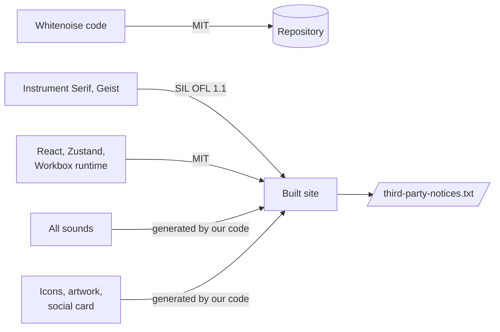

# Licensing

## Summary

| Part | License | Notes |
| --- | --- | --- |
| Whitenoise source code | MIT | [`LICENSE`](../LICENSE), © John Pranoy Yalla |
| React, React DOM, scheduler, Zustand | MIT | Bundled into the app |
| Workbox runtime (core, precaching, routing, strategies, expiration, cacheable-response, window) | MIT | Bundled into the service worker by `vite-plugin-pwa` (MIT) |
| Instrument Serif, Geist | SIL Open Font License 1.1 | Self-hosted from `@fontsource`; OFL allows bundling in websites |
| Sounds | Original | Every sound is synthesised by `src/audio/`; no recordings or samples are included |
| Icons, lock-screen artwork, social card | Original | Rendered from the app's own colors and textures; the card's text uses Instrument Serif (OFL permits rendering text into images) |

All third-party license texts are collected in [`public/third-party-notices.txt`](../public/third-party-notices.txt), served at `/third-party-notices.txt` and linked from the app's footer. Regenerate it with `npm run notices` whenever a dependency that reaches the browser is added or updated (the list lives in `scripts/notices.mjs`).

Build-only tools (Vite, TypeScript, the PWA plugin's build step) are not distributed, so their licenses don't need to be reproduced.

## Adding recordings

`public/sounds/` can hold real recordings that replace the synthesised nature sounds. Check each file's license before committing it, since the repository is public:

| License | OK? | Requirement |
| --- | --- | --- |
| CC0 (public domain) | Yes | None; crediting is still courteous |
| CC BY | Yes | Credit the author in `public/sounds/CREDITS.md` |
| CC BY-NC | Only while the app is non-commercial | Credit the author |
| Pixabay Content License | Avoid | Prohibits redistributing files as-is, which a public repo arguably does |
| Unknown / "free download" | No | Without a license you have no permission |

## Name and claims

- **"Whitenoise"** describes a generic sound and is a weak trademark candidate, so the risk is low for a free project; run a trademark search (e.g. USPTO) before any commercial launch.
- **No medical claims.** The app and its search metadata describe sounds only. See [HEALTH.md](HEALTH.md).
